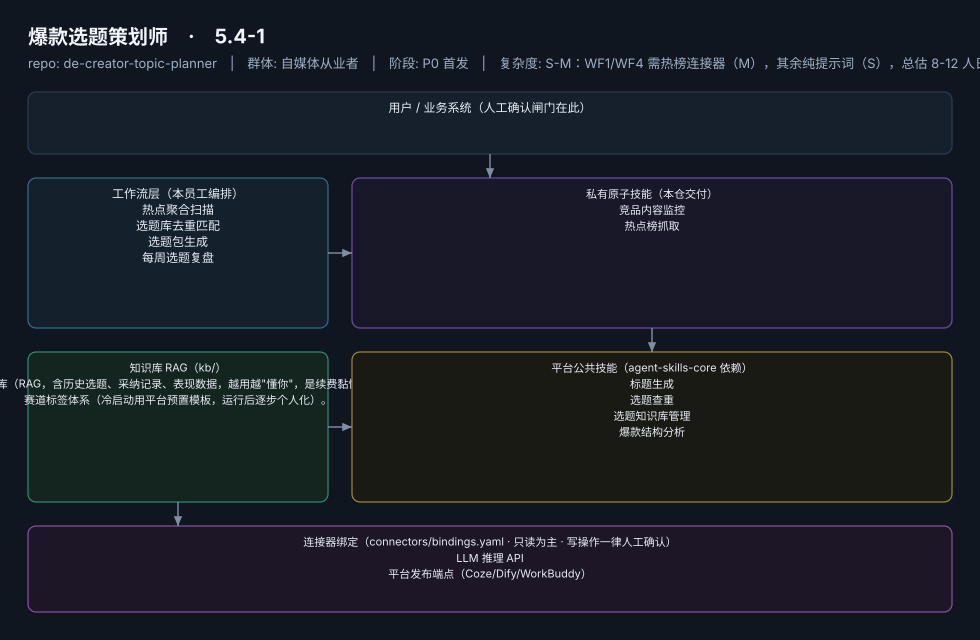

# 爆款选题策划师

> 每天早会前 5 分钟交付"今日选题包"的选题合伙人
>
> **5.4-1**　·　自媒体从业者　·　阶段 P0 首发　·　
> 复杂度 S-M：WF1/WF4 需热榜连接器（M），其余纯提示词（S），总估 8-12 人日　·　¥30-80/月；采纳"基础版免费开源 + 知识库高级版付费"双层策略（据 R5 调研）　·　定义卡 5.4-1



**一句话**：全体内容创作者（5000 万+，据 R2 调研），尤其日更压力的短视频/图文作者

---

## 这个数字员工解决什么问题

每天早会前 5 分钟交付"今日选题包"的选题合伙人

| 项 | 内容 |
|---|---|
| 服务对象 | 全体内容创作者（5000 万+，据 R2 调研），尤其日更压力的短视频/图文作者 |
| 可量化目标 | 选题包采纳率 ≥40%；每日选题耗时从 1h 压缩至 ≤10 分钟；选题库月净增 ≥30 条 |
| 投入产出 | 月省工时约 36h，折 ¥900-1400，对比订阅成本 ROI >10 倍 |
| 需求依据 | D01、D28、D12 |
| 分发渠道 | GitHub（必备基础渠道，开源免费版引流）、小红书、抖音、Coze扣子商店、腾讯WorkBuddy Skill市场 |

## 30 秒上手

```bash
git clone <本仓库地址> && cd de-creator-topic-planner
pip install pyyaml
python3 tests/run.py            # 先跑一遍自检，确认环境与契约都对得上
```

试用（把 `<输入>` 换成本人真实材料）：

```text
请以「爆款选题策划师」的身份，帮我跑「热点聚合扫描」。
材料如下：<输入>
要求：只使用材料里出现过的数字，缺的写 <待填>；对外文案停在待确认状态。
```

详细接入见 [`docs/01-安装与接入.md`](docs/01-安装与接入.md)。

## 仓库结构

```text
de-creator-topic-planner/
├── employee.yaml          # 机器契约（能力清单 + 依赖锁）
├── dependencies.yaml      # 对 core 的外部依赖（含版本）
├── persona/               # 运行提示词 / 边界 / KPI
├── skills/                # 私有原子技能（2 个）
├── spec-bindings/         # 有意不公共化能力的本地绑定声明（0 个）
├── workflows/             # 本员工工作流（4 条）
├── kb/                    # 知识库 RAG 契约
├── connectors/            # 连接器绑定（只读为主，写操作人工确认）
├── docs/                  # 六类发布文档
└── tests/                 # 自动化多场景测试
```

## 私有原子技能（2）

| 技能 | slug | 复杂度 | 阶段 | 成熟度 |
|---|---|---|---|---|
| `竞品内容监控` | `competitor-content-monitor` | M | P1 | 契约完备 |
| `热点榜抓取` | `trendboard-fetcher` | M | P0 | 契约完备 |

## 平台公共技能依赖（4）

| 技能 | slug | 全平台复用员工数 |
|---|---|---|
| `标题生成` | `title-generator` | 4 |
| `选题查重` | `topic-duplicate-check` | 1 |
| `选题知识库管理` | `topic-kb-manage` | 3 |
| `爆款结构分析` | `viral-structure-analysis` | 2 |

> 这些技能来自 `agent-skills-core@1.0.0`，本仓库**只引用不复制**。

## Spec 绑定层（0）

（无）

> 这一族能力**有意不公共化**（与外部平台接口强绑定）。本仓不存正文，
> 只留本地绑定声明与连接器配置。

## 工作流（4）

| 工作流 | slug | 触发 | 阶段 | 调用技能数 |
|---|---|---|---|---|
| `热点聚合扫描` | `wf-creator-topic-hot-aggregate` | 定时（每日 07:30） | P0 | 2 |
| `选题库去重匹配` | `wf-creator-topic-dedup` | 事件（WF1 完成后自动） | P0 | 2 |
| `选题包生成` | `wf-creator-topic-pack` | 事件（WF2 后自动，每日 08:00 前交付） | P0 | 2 |
| `每周选题复盘` | `wf-creator-topic-weekly-review` | 定时（每周一 09:00） | P1 | 2 |

## 知识库与连接器

- 知识库语料：['个人选题知识库（RAG，含历史选题、采纳记录、表现数据，越用越"懂你"，是续费黏性的底层资产）', '赛道标签体系（冷启动用平台预置模板，运行后逐步个人化）。']
- 连接器：LLM 推理 API、平台发布端点（Coze/Dify/WorkBuddy）

## 质量与验收

| 项 | 值 |
|---|---|
| 技能文件数 | 91 |
| 多场景用例数 | 193 |
| 用例通过 | 193 |
| 验收结论 | ✅ 通过 |

完整报告：[`docs/05-验收与测试.md`](docs/05-验收与测试.md)

## 许可

专有许可，详见 [`LICENSE`](LICENSE)。
